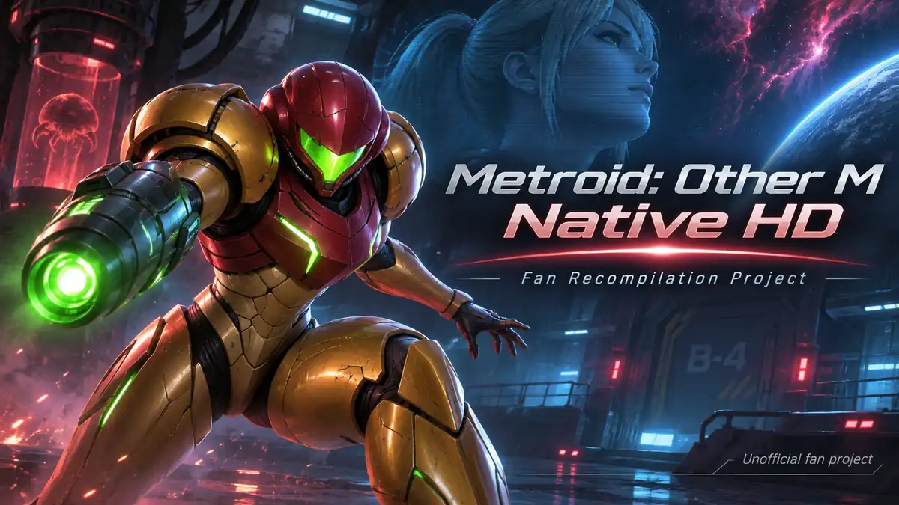

# Metroid: Other M Native HD

*Illustration de fan non officielle. Il ne s'agit pas d'une capture du jeu.*

Je développe un projet indépendant visant à faire fonctionner *Metroid: Other M* nativement sur PC grâce à la recompilation statique du code PowerPC de la Wii.

[English](README.md) | **Français**

[Architecture](docs/ARCHITECTURE.md) · [État technique](docs/BUILD_STATUS.md) · [Feuille de route](docs/ROADMAP.md) · [Journal](docs/DEVELOPMENT_LOG.md) · [FAQ](docs/FAQ.md)

## État du développement

Le démarrage natif atteint désormais le chargement du microcode audio DSP AX, après avoir franchi GXInit et exercé les services disque et Bluetooth. Je n'ai pas encore obtenu d'image de gameplay affichée ni de version jouable.

| Domaine | Derniers éléments documentés |
| --- | --- |
| Traduction PowerPC | 32 275 fonctions retraduites ; 732 tests du traducteur réussis dans l'exécution rapportée |
| Compilation native | Une génération antérieure de 30 045 fonctions compilée ; reconstruction des 32 275 fonctions rapportée |
| Runtime Wii | Changements de thread, registres spéciaux, interruptions, IOS, NAND, disque et initialisation Bluetooth exercés |
| Processeur graphique | GXInit franchi ; 291 commandes GX et 512 Kio de FIFO identiques à Dolphin au 35ᵉ appel IPC |
| Lecteur RVZ | Lecteur intégré en lecture seule ; vérifications du DOL, de la FST et d'extraits d'un grand fichier |
| Blocage actuel | Chargement du microcode audio DSP AX. Environ 1 290 images soumises au GPU émulé, **aucune affichée à l'écran** |

Mon dernier compte rendu de console du **1er novembre 2026** décrit ces jalons. Je n'ai pas reproduit indépendamment les tests du runtime pour cette mise à jour publique. Une image soumise au GPU n'est pas une image de gameplay affichée. Le jeu n'est toujours pas jouable. Voir l'[état technique](docs/BUILD_STATUS.md).

## Principe technique

La chaîne de développement traduit les instructions PowerPC de la Wii en C++, puis les compile pour le processeur du PC. Un runtime dédié prend en charge la mémoire, les interfaces matérielles et les services système Wii.

Ce projet **n'est pas un lanceur Dolphin**. Dolphin sert de référence pour les comparaisons de comportement et de mémoire. Le choix du backend graphique reste ouvert entre Aurora/Dawn, Vulkan direct et une éventuelle voie Direct3D 12.

## Fonctionnalités prévues

Il s'agit d'objectifs, pas de fonctionnalités déjà disponibles.

- **Systèmes et commandes :** Windows et Linux, clavier et souris, manettes Xbox et PlayStation, puis Wiimote via Mayflash DolphinBar.
- **Graphismes :** prise en charge prévue des formats 16:9 (écran large) et 21:9 (ultrawide), avec un champ de vision adapté plutôt qu'une image étirée ; affichage 1080p, 1440p et 4K, améliorations HD facultatives et fréquences pouvant atteindre 144 FPS si cela est techniquement réalisable. Le HDR10, le VRR, G-SYNC et AMD FreeSync sont aussi prévus comme options facultatives, avec retour au SDR classique. Aucune de ces technologies d'affichage n'est encore implémentée ni validée.
- **Optimisation :** maîtrise du CPU, du GPU, de la RAM et de la VRAM, compatibilité avec les PC modestes, préparation des shaders et tests automatisés.
- **Installation :** importation locale d'une copie personnelle du jeu, lanceur dédié et futur système de mises à jour.

La [feuille de route](docs/ROADMAP.md) présente les étapes et leurs limites.

## Lanceur et téléchargements

Je **publierai le lanceur prévu sur ce dépôt via [GitHub Releases](https://github.com/Petrus-Canisius/Metroid-Other-M-Native-HD/releases)** lorsqu'il sera prêt. Les joueurs devront posséder leur propre copie de *Metroid: Other M*. Aucun téléchargement ni date de sortie ne sont annoncés pour le moment.

Je développe ce projet sur mon temps libre. Le développement peut prendre du temps, mais je compte publier le lanceur ici.

## Suivre le développement

Je présente les jalons importants dans mon [journal](docs/DEVELOPMENT_LOG.md) et je réponds aux questions techniques et de distribution dans la [FAQ](docs/FAQ.md). Je révise manuellement les informations publiques à l'aide de ma [procédure de maintenance](docs/MAINTENANCE.md). La documentation technique détaillée est en anglais.

## Indépendance et droits

Je mène ce projet de fan de manière indépendante, sans affiliation, soutien ni approbation de Nintendo. Metroid et les noms associés appartiennent à leurs détenteurs respectifs. Ce dépôt ne distribue aucun code de jeu Nintendo, ressource du jeu, image disque, donnée NAND privée ou clé de chiffrement.

La [FAQ](docs/FAQ.md#licensing) présente les questions relatives aux licences tierces.
