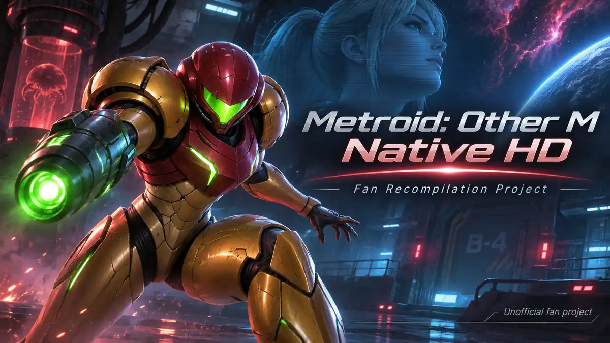

# Metroid: Other M Native HD

*Unofficial fan artwork. Not an in-game screenshot.*

An independent project aiming to run *Metroid: Other M* natively on PC through static recompilation of its Wii PowerPC code.

**English** | [Français](README.fr.md)

[Architecture](docs/ARCHITECTURE.md) · [Build status](docs/BUILD_STATUS.md) · [Roadmap](docs/ROADMAP.md) · [Development log](docs/DEVELOPMENT_LOG.md) · [FAQ](docs/FAQ.md)

## Development status

Early Wii startup code runs in a native development harness. The project has not produced a verified gameplay frame or a playable build.

| Area | Latest documented evidence |
| --- | --- |
| PowerPC translation | 32,275 functions generated, with some speculative discovery |
| Translator tests | 732 passed in the last inspected suite |
| Native compilation | 30,045 functions compiled in an earlier generation |
| Wii services | Interrupt and IOS work; a later developer log reports reading NAND `SYSCONF` |
| Scheduling | Native fibers under development; 55 polling loops identified for instrumentation |
| Disc and rendering | Disc reads under investigation; no verified gameplay rendering |

The latest NAND and wait-loop observations come from developer progress logs dated **1 November 2026**. They have not been independently reproduced for this documentation update. The numbers above are distinct milestones, not a game-completion percentage. See [build status](docs/BUILD_STATUS.md).

## How it works

The toolchain translates Wii PowerPC instructions into C++ and compiles them for a host CPU. A dedicated runtime implements Wii memory handling, hardware interfaces and operating-system services.

This is **not a Dolphin launcher**. Dolphin serves as a reference for behavior and memory comparisons. The graphics backend remains undecided between Aurora/Dawn and a possible direct Vulkan implementation.

## Planned capabilities

These are development goals, not currently available features.

- **Platforms and input:** Windows and Linux, keyboard and mouse, Xbox and PlayStation controllers, and future Wii Remote support via Mayflash DolphinBar.
- **Visuals:** 1080p, 1440p and 4K output, optional HD improvements and higher refresh rates up to 144 FPS where technically feasible.
- **Performance:** efficient CPU, GPU, RAM and VRAM usage, support for modest PCs, shader preparation and automated regression testing.
- **Installation:** local import of a personal game copy, a dedicated launcher and a future update mechanism.

See the [roadmap](docs/ROADMAP.md) for dependencies and limitations.

## Launcher and downloads

The planned launcher **will be distributed through this repository's [GitHub Releases](https://github.com/Petrus-Canisius/Metroid-Other-M-Native-HD/releases)** when it is ready. Players will need their own copy of *Metroid: Other M*. No download or release date is available yet.

I develop this project in my spare time. Progress may take considerable time, but my intention is to bring the launcher to this page.

## Follow development

Read the [development log](docs/DEVELOPMENT_LOG.md) for significant milestones and the [FAQ](docs/FAQ.md) for technical and distribution questions. Public updates are reviewed manually under the [documentation maintenance procedure](docs/MAINTENANCE.md).

## Independence and rights

This is an unofficial fan project. It is not affiliated with, endorsed by or approved by Nintendo. Metroid and related names belong to their respective owners. This repository contains no Nintendo game code, game assets, disc images, private NAND data or encryption keys.

Third-party license considerations are covered in the [FAQ](docs/FAQ.md#licensing).
