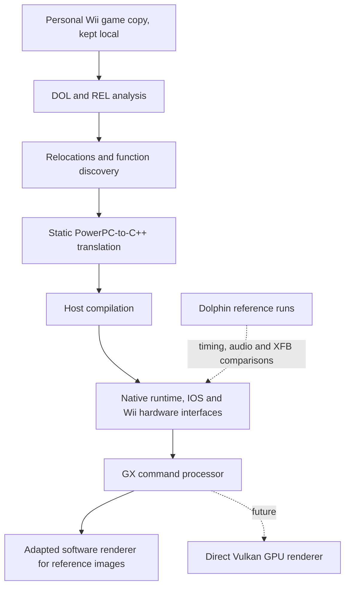

# Architecture

[Home](../README.md) · [Status](BUILD_STATUS.md) · [Roadmap](ROADMAP.md)

## Translation pipeline

My initial target is the PAL Wii revision identified locally as R3OP01. The Wii DOL executable and REL module are analyzed and relocated before their PowerPC functions are translated into host-compiled C++.

This diagram describes the development pipeline, not a downloadable installer. Dolphin is a diagnostic reference, **not the final execution engine**.

## Runtime and input

The native runtime implements portions of memory access, PowerPC special registers, thread switching, interrupts, NAND, IOS and direct read-only RVZ disc access. The Wii Remote emulator has a Bluetooth HCI controller, L2CAP/HID connection and input reports. Scripted input supplies Wii Remote buttons, accelerometer and infrared data during reproducible native tests.

At the 2 November 2026 milestone, **32,282 functions** have been translated, including seven extra indirect-entry points needed to progress after START. The reported translator suite passed **732/732** tests. This remains separate from gameplay correctness.

The DSP AX implementation processes voices and DMA samples. After aligning output timing, the first **17.09 seconds** of active audio matched Dolphin sample-for-sample. Later divergence remains under investigation.

## Software GX renderer: first native images

My CPU-side GX runtime already handles the gather pipe, CP/PE register interfaces, FIFO and command decoding. I have now connected an **adapted Dolphin software rendering pipeline** to that stream. The pipeline performs vertex work, rasterization, TEV, texturing and EFB-to-XFB copies. XFB images can be exported privately for comparison.

The **first Wii Remote wrist-strap warning image** matched Dolphin across **614,400/614,400 XFB bytes** when copy-filter configuration was aligned. Other early frames, including a black transition and some introduction frames, also matched exactly.

The native harness can display the strap screen, the METROID intro and OPTIONS, and accepts scripted inputs for settings changes, START, HOME and IR pointer movement. These later menu interactions are **native observations only**, not all independently reproduced in Dolphin.

The software renderer runs at approximately **28 FPS** in the reported full-screen test. It is **not appropriate as the final product renderer**. It remains a reference for future accelerated rendering. I currently favor **direct Vulkan** as the future GPU backend, behind the same graphics interface, but Vulkan rendering has **not yet been implemented**.

## Timing and validation boundaries

The emulated Wii clock still partly relies on host elapsed time. Software rendering initially affected emulated time and Wii Remote connectivity; that rendering-duration issue was mitigated, but a fully deterministic clock is unfinished. Time-dependent animated effects and input transitions can therefore differ in phase from Dolphin.

The reported 24 MiB memory comparisons remain open: **227 differing bytes at IPC #4** and **810 at IPC #35**. The **GX FIFO** remains identical to Dolphin at its validated checkpoint. The emulator is not yet proven equivalent across the full game.

Some GPU readback behaviors, such as bounding-box and pixel-engine counters, are incomplete. The test harness stops rather than inventing values if these registers are read.

## Future output and distribution

I am planning Windows and Linux builds. Advanced visual goals are 1080p, 1440p and 4K, 16:9 and 21:9, optional anti-aliasing, HDR10, VRR, G-SYNC and FreeSync, with optional configuration and SDR fallback. Anti-aliasing candidates include FXAA and SMAA, plus MSAA if the final GX-to-Vulkan pipeline supports it; TAA needs further feasibility testing. An off setting is required, and the pixel-accurate software reference renderer must not be modified by optional post-processing. They are **not implemented** in the current renderer. Game speed must remain independent of monitor refresh rate.

No native gameplay session or distributable launcher is verified. Captures, disc images, translated game code, NAND content and game assets remain private. The Dolphin-derived software graphics code and other reused components require a per-file license audit and applicable GPL obligations before any public software distribution.
