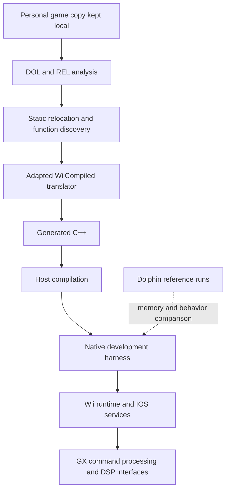

# Architecture

[Home](../README.md) · [Status](BUILD_STATUS.md) · [Roadmap](ROADMAP.md)

## Translation pipeline

The initial target is the PAL Wii revision identified locally as R3OP01. DOL contains the main executable and REL a relocatable module. My local toolchain discovers functions, applies relocations and statically translates PowerPC instructions into host-compiled C++.

This is a development architecture, not a distributed installer.

## Native runtime, reported 1 November 2026

My native development harness now passes GXInit. It implements parts of memory access, PowerPC special registers, interrupt and scheduler behavior, NAND filesystem services, disc commands and Bluetooth HCI. Linux host fibers are part of the scheduling layer. An instrumenter inserts safe points into short and side-effect-free-call polling loops to advance emulated time.

The **CPU-side GX interface** includes the gather pipe, command processor registers, FIFO, command decoding and binary capture. A reference comparison at the 35th IPC call matched 291 commands and the 512 KiB FIFO memory region. This does **not** generate pixels. A graphics rendering backend has not yet been selected or implemented.

An integrated **read-only RVZ** reader supports direct access to partition data from a local personal disc copy. Reported DOL, FST and large-file samples matched reference bytes. The IOS disc interface models seeks, rotation and buffering; comprehensive timing and compatibility validation remains pending.

The NAND subsystem now exercises directory enumeration, permissions, metadata and writes. A startup SYSCONF image reportedly matched Dolphin. Bluetooth HCI initialization is exercised with no connected Wii Remote. Full Bluetooth input emulation is still pending.

The AX Wii audio microcode is now processed through a Dolphin-derived high-level DSP/AX implementation. Its command frames, DMA capture and scheduled DSP/ARAM events run in the native harness. A reported register-restore fix enabled extended execution with 135,750 thread switches before the watchdog limit. However, both native and reference captures were silent without a connected Wii Remote. **Audible voice mixing has not been validated.**

The next reported dependency is Wii Remote L2CAP/HID input emulation. Speaker playback, full graphics rendering and a playable game session remain unfinished.

## Graphics and output architecture

Aurora/Dawn/WebGPU, direct Vulkan and a potential Direct3D 12 path remain under consideration. I have not selected a backend. Future output goals include 1080p, 1440p, 4K, 16:9 and 21:9, optional HDR10 and VRR compatibility (including G-SYNC and FreeSync where hardware permits), and appropriate fallback to SDR, 60 Hz and 16:9. These features are documentation-only goals at present.

Game timing must remain independent of monitor refresh rate. Display capability detection and frame-ready signaling are architectural requirements for a future renderer, not functioning features in the current boot harness.

## Validation and distribution boundaries

Dolphin is an external development reference, **not the intended final execution engine**. Reported runtime comparisons have not been independently rerun for this public update. The boot harness uses private development snapshots. No consumer installation flow or playable build is verified.

Public documentation must not contain private GX captures, extracted game data, game binaries, encryption keys or Nintendo assets. Any eventual redistribution of Dolphin-derived or other third-party code requires a per-component license review and corresponding source obligations where applicable.
