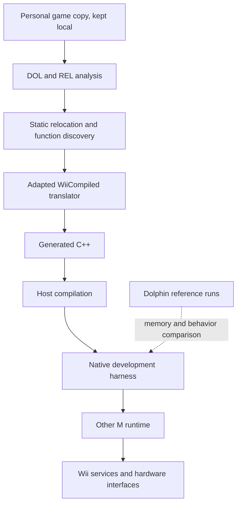

# Architecture

[Home](../README.md) · [Status](BUILD_STATUS.md) · [Roadmap](ROADMAP.md)

## Translation pipeline

The initial target is the PAL Wii revision identified locally as R3OP01. DOL contains the main executable. REL contains a relocatable module. Local analysis establishes the module layout and applies relocations before translation.

This diagram describes the development pipeline. It is not an available installer.

## Current implementation

C++20 tools parse executables, decode Broadway instructions and inspect control flow. WiiCompiled translates discovered functions to C++. Clang compiles the generated code for native execution.

The dedicated runtime implements parts of memory access, hardware registers, interrupts, event scheduling and IOS communication. Linux thread handling uses host fibers through `ucontext`. A partial host backed NAND filesystem is present. Wait loop analysis helps identify places where pending events and interrupts must be serviced.

The boot harness currently relies on private development snapshots. That startup method does not establish an independent consumer boot path.

## Boundaries still under development

Disc register handling does not imply functional IOS disc reads. The inspected IOS disc command handler stops explicitly on unimplemented requests.

The graphics architecture is open. Aurora with Dawn/WebGPU and direct Vulkan are candidates. Neither is presented as the selected backend. Input, audio playback, scene rendering and a complete game session still require implementation and validation.

Dolphin is an external diagnostic reference. Hardware behavior in the native runtime still needs emulation or compatible service implementations. Native CPU execution does not remove those requirements.
